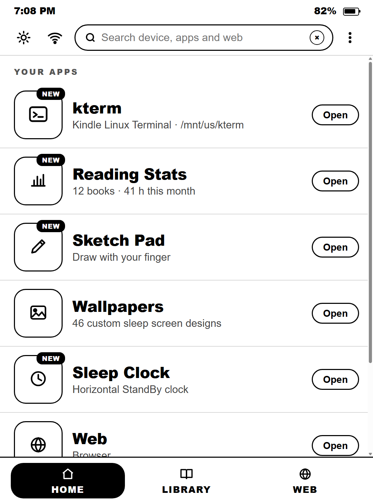
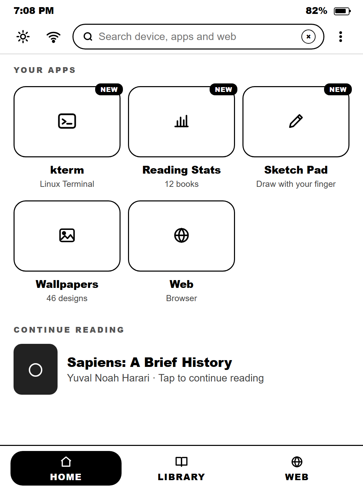
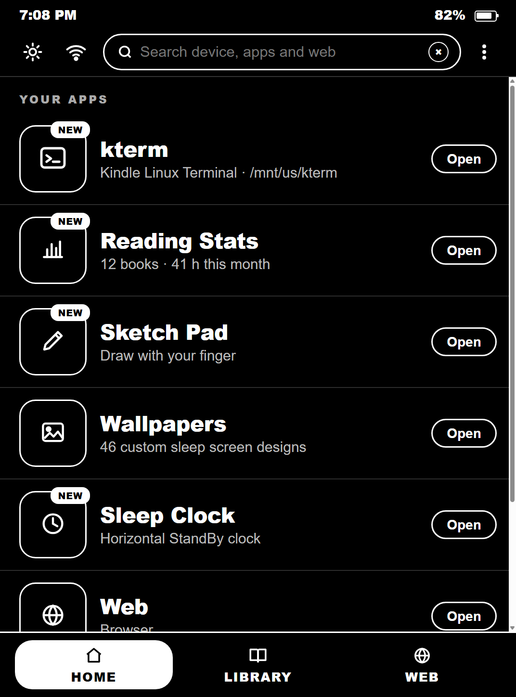
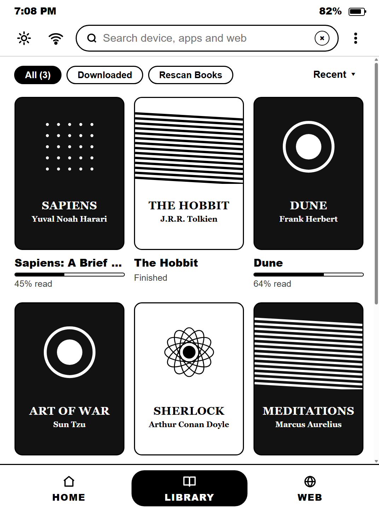
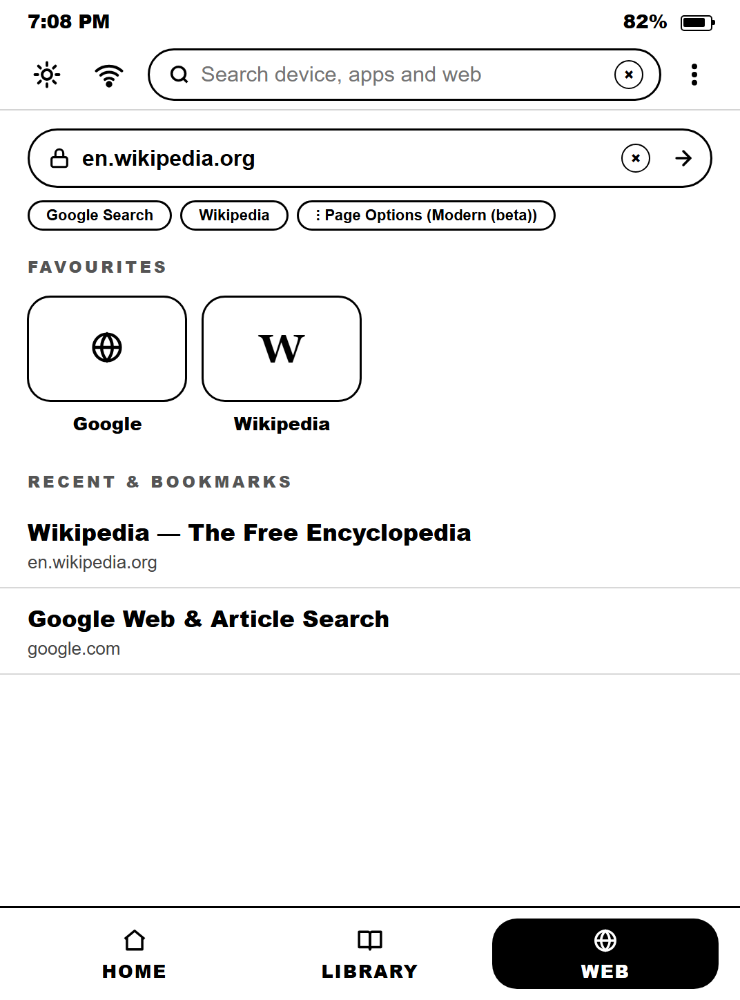
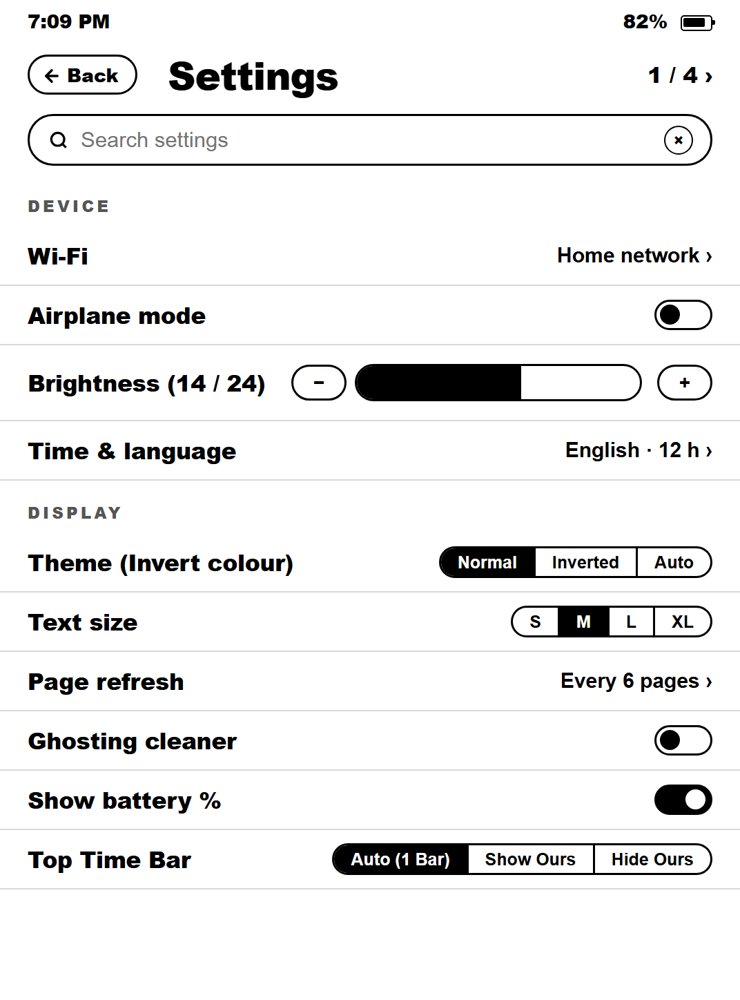

# Paperwhite OS v4.7

A custom full-screen E-Ink launcher, reader, standby clock, and sketch pad crafted specifically for the **Kindle Paperwhite 3 (7th Gen, `wario` board, firmware `5.16.2.1.1`, `1072×1448` 300 PPI display)**.

Built on Kindle's native Web Application Framework ([Mesquite & WAFs Reference](https://github.com/penguins184/Penguins-Kindle-Wiki/blob/main/Mesquite-WAFs.md)) and managed cleanly via [Awesome Window Manager](https://kindlemodding.org/kindle-dev/awesome-window-manager/), [com.lab126.appmgrd](https://kindlemodding.org/kindle-apps-and-services/com.lab126.appmgrd.html), [com.lab126.pillow](https://kindlemodding.org/kindle-apps-and-services/com.lab126.pillow.html), and [com.lab126.powerd](https://kindlemodding.org/kindle-apps-and-services/com.lab126.powerd.html).

## Interface Preview

| Home (List View) | Home (Grid View) | Inverted Night Mode |
| :---: | :---: | :---: |
|  |  |  |

| Paginated Library | Web Portal | System Settings |
| :---: | :---: | :---: |
|  |  |  |

## Key Features in v4.7

- **Full-Screen Chromeless Window (`PC:N`)**: Launches `app://com.paperwhite.os` with the chromeless [Awesome Window Manager](https://kindlemodding.org/kindle-dev/awesome-window-manager/) window title `L:A_N:application_PC:N_ID:com.paperwhite.os` and disables stock chrome overlays via [com.lab126.pillow](https://kindlemodding.org/kindle-apps-and-services/com.lab126.pillow.html) so only Paperwhite OS's custom E-Ink status bar is displayed.
- **Accurate Live Hardware Battery**: Reads real-time charge percentage and charging state every 24 seconds from [com.lab126.powerd](https://kindlemodding.org/kindle-apps-and-services/com.lab126.powerd.html) (`battLevel`), `gasgauge-info -s` ([Kindle Battery Percentage Discussion](https://www.mobileread.com/forums/showthread.php?t=117072)), and `/sys/devices/system/wario_charger/wario_charger0/charging` ([KPW3 Sysfs Reference](https://bookfere.com/post/1103.html)) via `live_battery.js`.
- **Responsive Native-DPI E-Ink Scrolling**: Disables 96-DPI scaling (`enforce96DPI="no"`) in `paperwhite-os/waf/config.xml` ([Understanding config.xml](https://kindlemodding.org/wafs-and-mesquite/understanding-config-xml.html)) for crisp `1:1` rendering at `1072×1448`, paired with touch drag + flick momentum scrolling and zero background `xprop` overhead while active.
- **25-Step Hardware Frontlight Control (`0–24`)**: Adjusts frontlight intensity directly via `flIntensity` on [com.lab126.powerd](https://kindlemodding.org/kindle-apps-and-services/com.lab126.powerd.html) through zero-UI helper bridges (`bright/b_0.html`..`b_24.html`).
- **Automatic Boot Launch & 1-Tap Library Installer**: Starts automatically on boot via an Upstart job tailored for PW3 `5.16.2.1.1` ([KOReader Autostart Task Reference](https://gist.github.com/SuleMareVientu/822b2b51d1ea043ce2b190669c0df38b)) and includes a 1-tap `documents/Install_Paperwhite_OS.sh` scriptlet compatible with [WinterBreak](https://hackerdude.tech/projects/2025-01-01-winterbreak/) and [KindleModding Hotfix `sh_integration`](https://github.com/KindleModding/Hotfix/issues/11) ([Illusion Generic Scriptlet Guide](https://github.com/forksnd/Illusion/blob/main/Getting-Started/Illusion-Generic-Scriptlet.md)).
- **Native `kterm` Launcher**: One-tap, zero-retry launch of [kterm](https://www.mobileread.com/forums/showthread.php?t=280024) on its own clean Layer-`D` dialog, with Pillow chrome toggled off automatically.
- **Horizontal StandBy Clock (`Sleep Clock`)**: Full-screen `90°` landscape desk clock with 5 switchable faces (Flip Clock, Analog + Monthly Calendar, Giant Bubble Digital, World Dot-Matrix Map, and Analog + Climate Split) and invisible tap zones.
- **Sketch Pad & Readable Book Library**: Rounded E-Ink drawing studio with Pen, Marker, Shapes, Grid, Undo, Save, and inline Wikipedia lookup, alongside a paginated reader (`scan_books.sh`) supporting `.txt`, `.epub`, `.mobi`, `.azw`, and `.azw3` files in `/mnt/us/documents/` plus 4 built-in public-domain classics.
- **46 Grayscale `1072×1448` Sleep Wallpapers**: Pre-rendered 300-PPI E-Ink screensavers selectable directly from Settings.
- **Reading Stats**: Live local tally of readable books, battery, and free storage, pulled straight from the device.

## Live Browser Demo (GitHub Pages)

The root `index.html` file is a standalone interactive demo of **Paperwhite OS v4.7** that runs in any desktop or mobile browser. Once pushed to GitHub, enable [GitHub Pages](https://docs.github.com/en/pages/getting-started-with-github-pages/configuring-a-publishing-source-for-your-github-pages-site) from the **`main` branch / `/ (root)`** folder to host the live interactive preview automatically.

## Installation on Kindle Paperwhite 3 (7th Gen)

> **Prerequisites**: A jailbroken Kindle Paperwhite 3 (`wario`, firmware `5.16.2.x`) with [WinterBreak](https://hackerdude.tech/projects/2025-01-01-winterbreak/) and [KindleModding Hotfix `sh_integration`](https://github.com/KindleModding/Hotfix/issues/11) installed.

1. Download **`paperwhite-os-cfw-bundle.zip`** from the [Releases](https://docs.github.com/en/repositories/releasing-projects-on-github/about-releases) page (or copy the contents of `kindle-root-bundle/` in this repository) and extract everything directly into the root of your Kindle USB drive (`F:\` on Windows or `/Volumes/Kindle` on macOS) so `install.sh`, `uninstall.sh`, `apps/`, `documents/`, and `paperwhite-os/` sit at the top level.
2. Safely eject your Kindle, open **Your Library**, and tap **`1. Install Paperwhite OS 4.7`** (or run `sh /mnt/us/install.sh` inside [kterm](https://www.mobileread.com/forums/showthread.php?t=280024)). Paperwhite OS v4.7 will symlink the WAF bundle, start the background battery/wallpaper service, and open immediately in full-screen chromeless mode.

## Uninstallation & Recovery

- **From SSH or kterm**: Run `sh /mnt/us/uninstall.sh` to remove the Upstart autostart hook, restore stock Mesquite launchers, re-enable Pillow chrome, and return cleanly to the standard Kindle home screen.
- **USB Safe Recovery**: Create an empty file named `DISABLE_PWOS` at the root of the Kindle USB drive (`/mnt/us/DISABLE_PWOS`) and reboot; the boot daemon detects this flag and skips launching Paperwhite OS automatically.

## Repository Structure

```text
.
├── index.html                    # Interactive standalone WebApp demo (GitHub Pages ready)
├── README.md                     # Project overview, architecture, and setup guide
├── HANDOFF_CONTEXT.md            # Complete technical & chat-continuation reference
├── LICENSE                       # MIT License
├── builder/
│   └── build_cfw.py              # Master Python generator script for v4.7 bundle & WebApp
├── kindle-root-bundle/           # Extracted Kindle USB root files (/mnt/us/*)
│   ├── install.sh                # Root installer script
│   ├── uninstall.sh              # Clean uninstaller & stock restore script
│   ├── apps/com.paperwhite.os/   # Launcher manifest, icon, and WAF entry point
│   ├── documents/                # 1-Tap Library Scriptlet (Install_Paperwhite_OS.sh)
│   └── paperwhite-os/            # waf/config.xml, boot_daemon.sh, watchdog, scan_books.sh, cloudflare-worker/, bright/, wallpapers/
├── screenshots/                  # UI mockups and wallpaper contact sheets
└── wallpapers-source/            # Original full-resolution artwork sources
```

## Rebuilding from Source

To regenerate both `paperwhite_os_menu.html` (`index.html`) and `paperwhite-os-cfw-bundle.zip` after editing `builder/build_cfw.py`:

```bash
python3 builder/build_cfw.py
```

> **Windows note**: if you hit a `UnicodeEncodeError` while building, run `set PYTHONUTF8=1` (cmd) or `$env:PYTHONUTF8=1` (PowerShell) first, since the script writes UTF-8 files.

## License

Released under the MIT License. See `LICENSE` for details.
